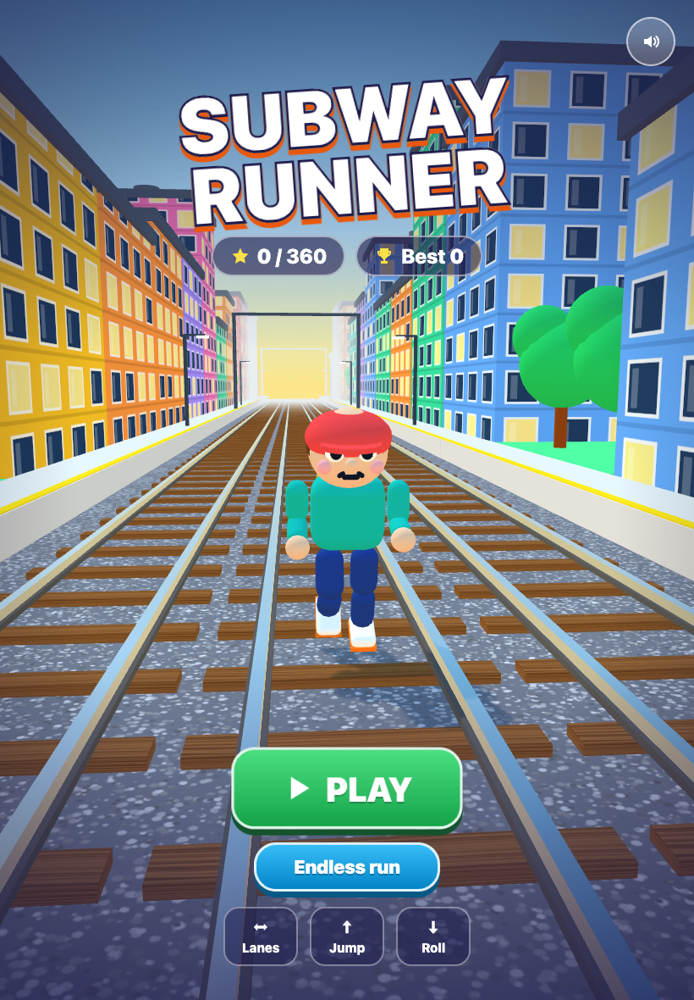
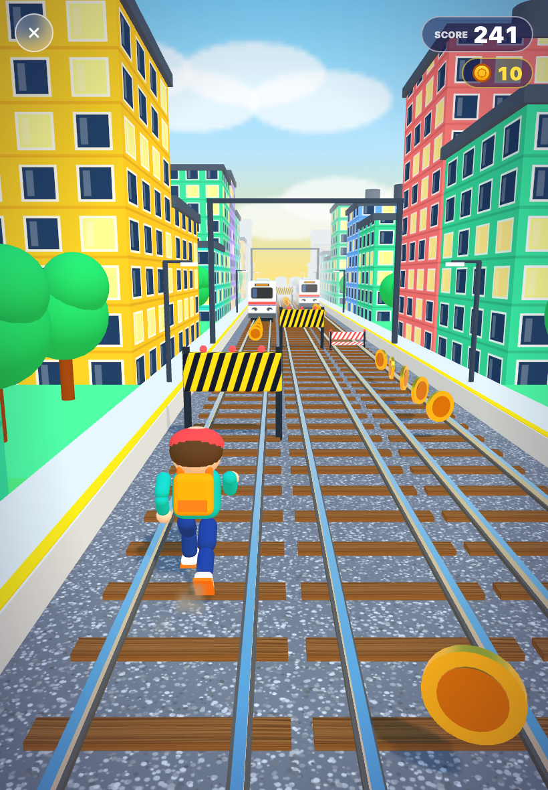
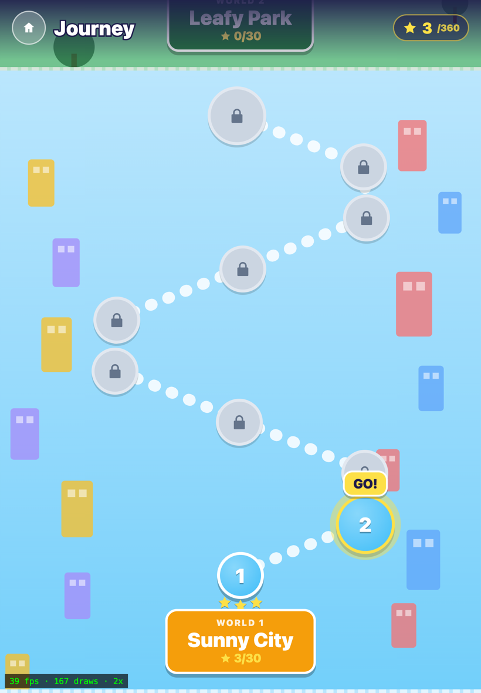
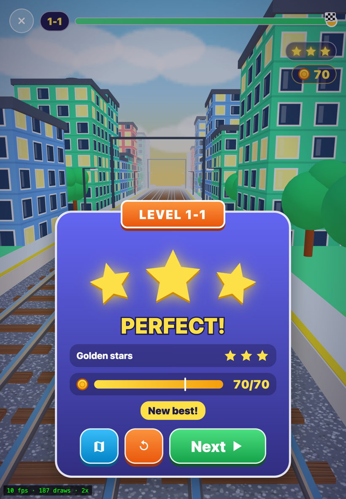
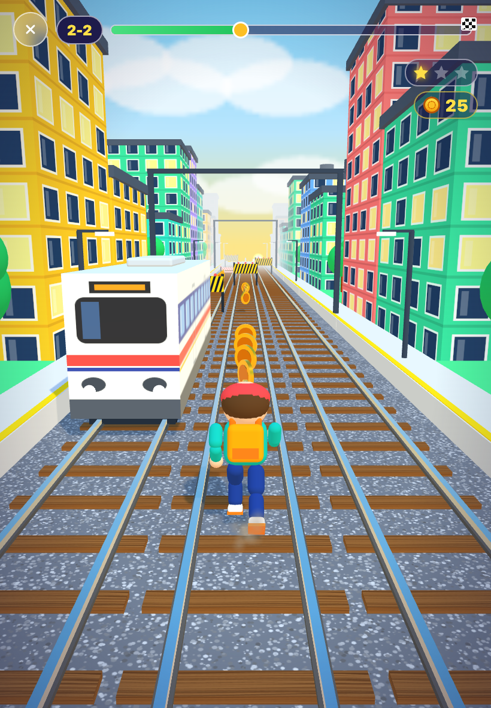
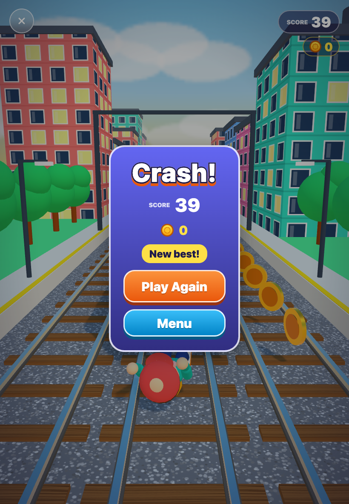

<p align="center">
  
</p>

<p align="center">
  <b>A fast, friendly 3D endless runner. Dash down three railway lanes, dodge trains, grab coins.</b><br>
  Free · offline · no ads · no accounts
</p>

<p align="center">
  
  
  
  
</p>

## What is it?

Swipe left/right to change lanes, up to jump hurdles, down to roll under bars, and weave around trains. Play an **endless run** for a high score, or follow the **Journey**: a map of levels across themed worlds (Sunny City, Leafy Park, ...) with up to three golden stars per level.

## Two builds, one game

| | Path | Stack | Status |
|---|---|---|---|
| **Web / PWA** | [`web/`](web) | TypeScript, Three.js, Vite | Active. Journey mode, installable, works offline |
| **iOS app** | [`App/`](App), [`GameCore/`](GameCore) | Swift, SceneKit, SwiftUI | First iteration, endless mode, App Store assets in [`store/`](store) |

The Swift code is **not** leftover: it is the original native game. The web build is a faithful port of its game logic (seeded RNG, track generation, runner physics, autopilot all exist in both and are tested in both), then extended with the Journey. New features currently land in the web build first.

## Run the web build

```bash
cd web
npm install
npm run dev      # http://localhost:5173
npm test         # vitest
npm run build
```

`npm run deploy` publishes to a home server over local HTTPS (see [`web/scripts`](web/scripts)).

## Build the iOS app

Needs Xcode and [XcodeGen](https://github.com/yonaskolb/XcodeGen).

```bash
xcodegen generate
open SubwayRunner.xcodeproj
cd GameCore && swift test   # core logic tests
```

## Repo map

- `web/src/core` platform-free game logic (mirrors `GameCore`)
- `web/src/gfx` Three.js scene, character, coins, effects
- `web/src/ui` journey map and worlds
- `GameCore/` Swift package with the same logic and tests
- `docs/site` privacy page and landing site; `docs/superpowers/plans` design plans

<details>
<summary>More screenshots</summary>
<p>
  
  
</p>
</details>
